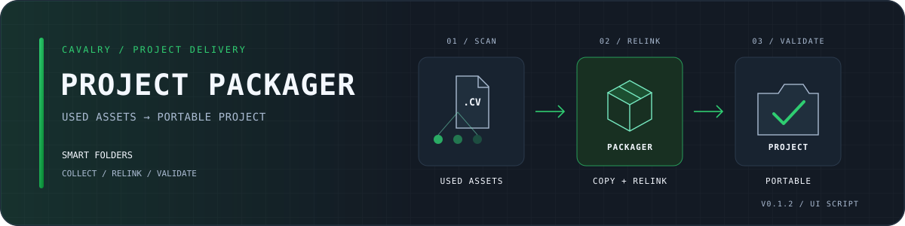

# Cavalry Project Packager

Package the file assets your Cavalry Compositions actually use into a portable Project, with Smart Folder relinking and post-package validation.

[中文说明](README.zh-CN.md) · [Download v0.1.2](https://github.com/luoboruodai/cavalry-project-packager/releases/tag/v0.1.2) · [Installation](docs/INSTALL.md) · [Changelog](CHANGELOG.md)

**v0.1.2** · Single-file Cavalry UI Script · macOS / Windows · English / 中文

<div align="center">



[](https://github.com/luoboruodai/cavalry-project-packager/actions/workflows/ci.yml)
[](https://github.com/luoboruodai/cavalry-project-packager/releases/tag/v0.1.2)
[](LICENSE)

</div>

## Release status

| Product | Status | Package |
| --- | --- | --- |
| Cavalry Project Packager | `v0.1.2` · documentation and distribution refresh | One Cavalry UI Script, bilingual offline guides, MIT |

The collection, relinking and rollback behaviour is carried forward from `v0.1.1`; this release focuses on the repository, installation experience and verifiable release artifacts.

## What it does

- **Collects used file assets:** images, footage, audio, data, image sequences, Smart Folders and optional external references or fonts.
- **Keeps Smart Folders intact:** preserves folder hierarchy, rebuilds the packaged Smart Folder asset and rewires its connections instead of collapsing it to one child file.
- **Creates a portable Project:** copies assets, relinks the packaged Scene and writes `Scenes/path-to-project` for relocation.
- **Supports focused handoff:** package every Composition or only the selected/active Composition and its nested Pre-Comps.
- **Checks the result:** missing files and sequence gaps block packaging; the packaged Scene is reopened and validated, with rollback on failure.
- **Speaks English and Chinese:** switch the script interface without changing the project.

## Download

| File | Purpose |
| --- | --- |
| [Cavalry-Project-Packager-v0.1.2.zip](https://github.com/luoboruodai/cavalry-project-packager/releases/download/v0.1.2/Cavalry-Project-Packager-v0.1.2.zip) | Ready-to-copy script, bilingual offline installation guides and LICENSE |
| [SHA256SUMS.txt](https://github.com/luoboruodai/cavalry-project-packager/releases/download/v0.1.2/SHA256SUMS.txt) | SHA-256 for the installation archive |

**Use the installation ZIP, not GitHub's automatic “Source code” archive.**

[Release notes](https://github.com/luoboruodai/cavalry-project-packager/releases/tag/v0.1.2) · [Installation guide](docs/INSTALL.md) · [中文安装指南](docs/INSTALL.zh-CN.md)

## Install and use

1. Download the ZIP and verify it against `SHA256SUMS.txt`.
2. In Cavalry, choose **Scripts → Show Scripts Folder**. Copy `Project Packager.js` from the archive's `Scripts` folder into that directory.
3. Reopen **Scripts → Project Packager**. Open and save a `.cv` Scene before scanning.
4. Choose the whole project or a selected Composition, set the destination and a new package name, then click **Scan Used Assets**.
5. Review the scan and click **Package Project**. Share the entire generated Project folder, not only the `.cv` file.

The full guide covers verification, upgrades, removal and recovery: [English](docs/INSTALL.md) · [中文](docs/INSTALL.zh-CN.md).

## Output structure

```text
<Package name>/
├─ projectDescription.json
├─ Assets/
│  ├─ Images/  Footage/  Audio/  Data/
│  ├─ Sequences/  SmartFolders/  Fonts/  References/
├─ Scenes/
│  ├─ <original Scene name>.cv
│  └─ path-to-project
├─ Renders/
├─ Autosave/
└─ package-report.json
```

## Behaviour and limits

- Packaging **saves the source Scene once** before copying. Test on a project copy first.
- **Clean package Assets** removes unused Assets-window items only from the packaged copy; it does not prune the source Scene.
- Fonts are reported but not copied by default. Enable copying only when the font licence permits redistribution.
- External `.cv/.cvc` references can be copied, but their own dependencies are not collected recursively.
- Online or non-file dependencies, such as Google Sheets, remain external and are reported as warnings.
- `package-report.json` contains source-machine absolute paths. Review or remove it before sharing; removing the report does not affect the packaged Scene.
- Complete a real migration test before delivery. Node mocks and CI archive checks do not replace validation in your Cavalry installation.

## Build, test and release

Development requires Node.js and Python 3. Neither is needed to run the installed Cavalry script.

```sh
node --check "src/Project Packager.js"
node --test tests/project-packager.test.cjs
python3 packaging/build_release.py
python3 packaging/build_release.py --verify-dir dist/release
```

CI runs the source checks on Ubuntu, macOS and Windows, then builds and verifies the installation archive. See [Development notes](docs/DEVELOPMENT.md) for the architecture, Cavalry API findings and release process.

## Credits and licence

Continued from [shouzhang123/cavalry-project-packager](https://github.com/shouzhang123/cavalry-project-packager), with bilingual UI and Smart Folder packaging fixes. The upstream project drew ideas from [Canvalry Scripts](https://github.com/phillip-motion/Canvalry-scripts).

[MIT License](LICENSE) · Copyright © 2025 Phill T
