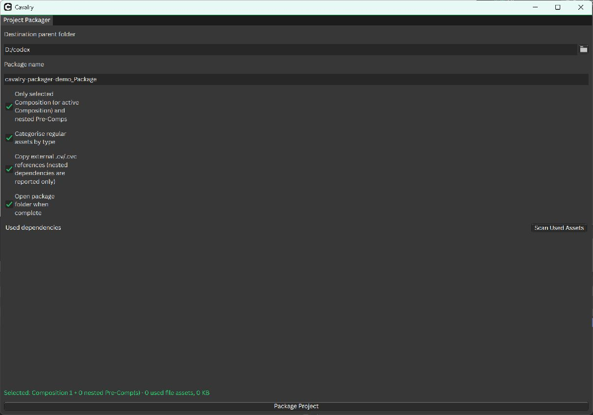

# Cavalry Project Packager

一个用于 Cavalry 的单文件 UI Script：收集工程中实际使用的文件素材，复制到新 Project，重链素材，并将 Scene 副本保存到包内。支持按整个工程或一个选定合成（包含嵌套 Pre-Comp）打包。当前版本：**1.1.0**。

> A single-file Cavalry UI Script that collects used file assets, relinks them inside a new Project, and saves a packaged Scene. The selected-composition mode includes nested Pre-Comps.



上图使用全新空白演示 Scene 截取，因此显示 `0 used file assets`；它不是任何用户的生产工程，也不是含素材工程的打包结果。

## 下载安装

从 [Releases](https://github.com/shouzhang123/cavalry-project-packager/releases) 下载 ZIP，解压后只需安装 `Project Packager.js`。也可以直接下载 [脚本源文件](src/Project%20Packager.js)。

1. 在 Cavalry 中点 **Scripts → Show Scripts Folder**。
2. 把 `Project Packager.js` 复制到打开的文件夹根目录。Windows 的常见路径是 `%APPDATA%\Cavalry\Scripts\`；macOS 的常见路径是 `~/Library/Application Support/Cavalry/Scripts/`。
3. 回到 Cavalry，重新打开 **Scripts** 菜单，点击 **Project Packager**。这是 `.js` 脚本，不需要额外安装 `.jsc` 或整个 Canvalry-scripts 仓库。

## 使用方法

1. 打开并保存一个 `.cv` Scene。`.cvc` Component 不能直接作为源 Scene；请先导入 Scene。
2. 默认打包**所有合成实际使用**的文件素材。如果只要一个合成，先在 Assets 窗口选中该 Composition，然后勾选 **Only selected Composition (or active Composition) and nested Pre-Comps**。未选中合成时使用当前活动合成；嵌套 Pre-Comp 会一起处理。此选项默认关闭，不改变原有的全工程打包方式。
3. 选择已存在的 **Destination parent folder**，填写一个尚未存在的 **Package name**。不会合并或覆盖旧包。
4. 点击 **Scan Used Assets** 检查数量、路径、缺失文件和警告，再点击 **Package Project**。
5. 分享或迁移时发送**整个包目录**，不要只发送 `Scenes` 中的 `.cv`。建议先把整包移到其他目录，重新打开包内 Scene 核对素材路径。

输出大致如下：

```text
<Package name>/
├─ projectDescription.json
├─ Assets/
│  ├─ Images/  Footage/  Audio/  Data/
│  ├─ Sequences/  SmartFolders/  References/
├─ Scenes/
│  ├─ <原 Scene 名>.cv
│  └─ path-to-project
├─ Renders/
├─ Autosave/
└─ package-report.json
```

## 行为与限制

- 脚本会在打包开始前**保存一次源 Scene**：当前未保存的改动会写入源 `.cv`。之后素材复制和重链发生在新包；限定合成模式只清理**包内副本**中的无关合成与素材，不删除源素材。
- 图片序列会逐帧收集；Image/Audio Smart Folder 会保留目录层级。缺失素材、序列缺帧或扫描错误会阻止打包。
- 字体只报告，不复制。外部 `.cv/.cvc` 引用可选择复制，但不会递归收集这些外部工程内部的依赖。
- 失败时会尝试恢复原 Scene 和 Project，并保留失败包与报告以便排查；出现恢复警告时请手动重新打开原 Scene 核对。
- `package-report.json` 包含原素材的本机绝对路径；对外分享前请检查或移除该报告，避免泄露本机目录信息。移除报告不影响包内 Scene 与素材使用。
- 自动测试覆盖扫描、序列、选定合成、回滚等模拟场景；仍请先在工程副本上验证，并在交付前做一次整包迁移测试。

## 开发测试

需要 Node.js 时，可运行：

```powershell
node --check "src/Project Packager.js"
node --test tests/project-packager.test.cjs
```

## 致谢与许可

本脚本部分基于 [Canvalry Scripts](https://github.com/phillip-motion/Canvalry-scripts) 的素材整理思路与代码。原项目采用 MIT License（Copyright © 2025 Phill T）；仓库保留 [MIT 许可文本](LICENSE)。
